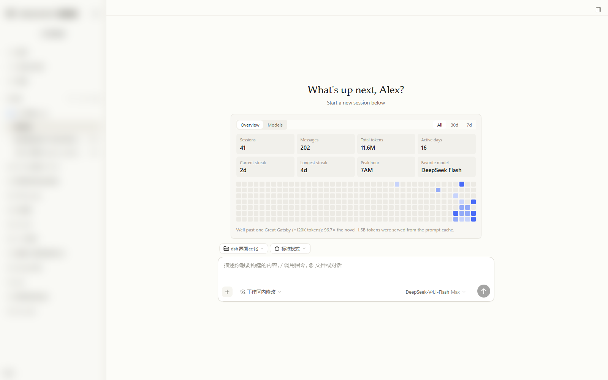
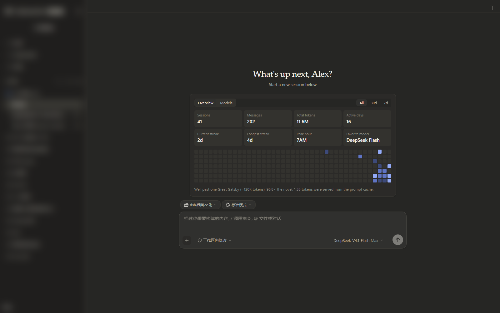
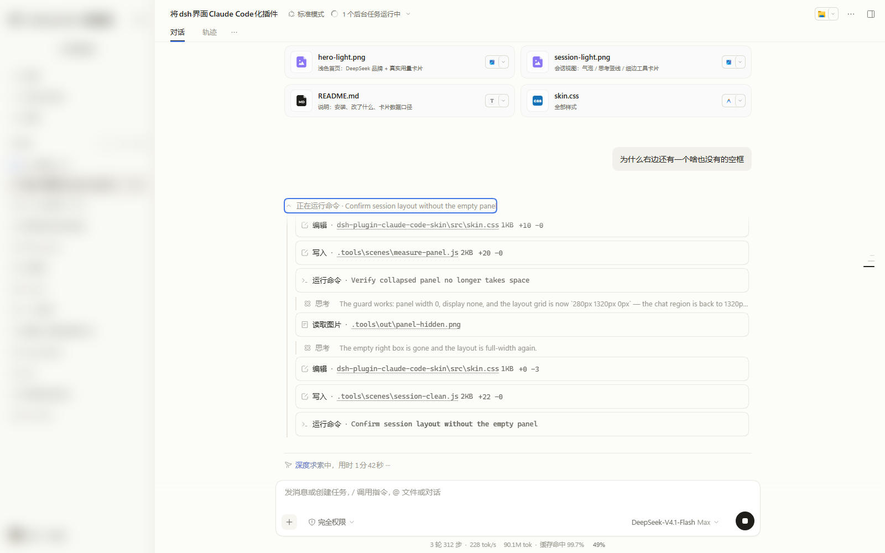
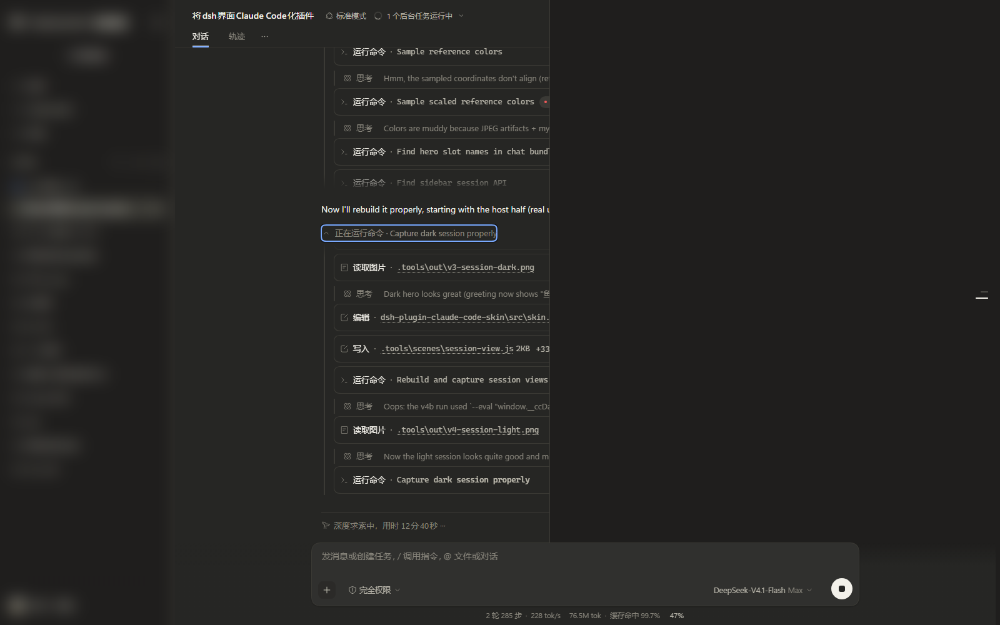
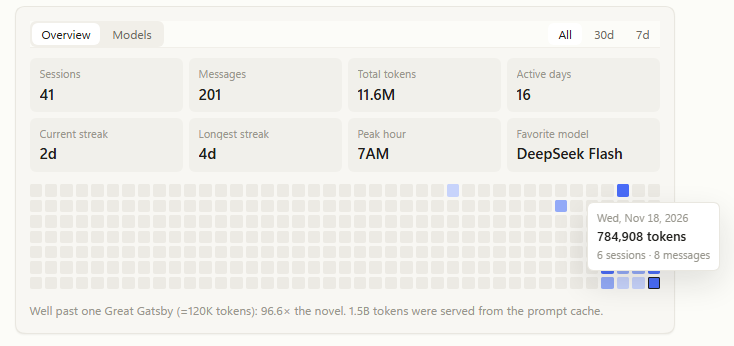

# dsh-plugin-claude-code-skin

一个给 **DeepSeek Harness（DSH）** Web GUI 用的 Claude Code 风格皮肤：暖白纸感底、
细边卡片、衬线大标题、等宽字体的终端质感，并把 Claude 风格的**用量总结卡片**
做成真的——数字来自本机会话数据，离线、只读，另外附一套同版式的深色。

> A Claude Code–style skin for the DeepSeek Harness web GUI, with a live usage
> card fed by local session data. Windows, DSH desktop / `dsh web`.

| 浅色 · 首页 | 深色 · 首页 |
| --- | --- |
|  |  |

| 浅色 · 会话 | 深色 · 会话 |
| --- | --- |
|  |  |

配色跟随 DSH 自己的「外观设置」：**浅色是默认的纸感主题**，深色是同一套版式的
深色版（暖炭灰底、同样的卡片 / 边框 / 间距）。截图里的侧栏做了模糊处理。

---

## 一、安装

```powershell
git clone https://github.com/XuYui/dsh-plugin-claude-code-skin.git
cd dsh-plugin-claude-code-skin
powershell -NoProfile -ExecutionPolicy Bypass -File .\install.ps1
```

`install.ps1` 只动 profile 目录（每项都先备份成 `*.bak-claude-code-skin`）：

1. 在 `<profile>\node_modules\` 为本目录建一个目录联接（junction）；
2. 把 `dsh-plugin-claude-code-skin` 追加到 `<profile>\package.json` 的
   `dsh.profile.bundles`；
3. 打印后续提示。

安装后 profile HMR 会自动重载：浏览器端样式与首页卡片立即生效，宿主端的用量
路由在重载时注册。如果窗口还是旧样子，按 `Ctrl + R` 刷新页面即可。

卸载：

```powershell
powershell -NoProfile -ExecutionPolicy Bypass -File .\uninstall.ps1
```

临时关掉不卸载：在 `cordis.patch.yml` 的那一行加 `disabled: true`。

## 二、设计取舍（对照 Claude 风格）

| 问题 | 这版的处理 |
| --- | --- |
| 边框有重叠 | 「新会话」按钮去掉外框，改成参考风格那样的纯文字导航行；卡片 / 输入框统一只用 1px 描边，不再叠加阴影与第二层边框 |
| 左上角不是 DeepSeek | 品牌原样保留：鲸鱼 mark + `deepseek HARNESS` 字标，不替换成别的字 |
| 没有用量总结页面 | 首页真的做出 `Overview / Models` + `All / 30d / 7d` + 8 个数据格 + 热力图 + 页脚那句话，数字来自本机会话真实统计 |
| 整体差异太大 | 换成参考风格的设计语言：暖白 `#fcfcf8` 底、`#f9f9f5` 侧栏、`#e9e7e0` 细边、圆角 12 的卡片、衬线大标题、圆角 18 的输入框、胶囊标签 |

顺带对齐的细节：会话里用户消息回到右侧浅灰气泡；思考过程是「细竖线 + 灰色
标签」，不再是卡片；工具调用是细边卡片，命令与输出在 `#f6f5f0` 的内嵌面上用
等宽字体；右侧面板、菜单、弹窗统一细边 + 柔和阴影；发送键改成中性深色圆形。

## 三、用量卡片的数据是真的

首页卡片由两部分组成：

- **宿主半边**（`lib/index.js`）注册一个只读路由 `GET /claude-code-skin/usage`，
  扫描 `$DSH_HOME/storages/session_projcache/sessions/session-*.json`（DSH 自己
  的会话投影缓存），按文件 mtime 做缓存，返回每个会话的
  `{createdAt, messages, turns, tokens, cacheReadTokens, model, title}`。
- **浏览器半边**（`src/boot.js`）把卡片挂到 DSH 首页里那处空白的
  `.hero .body` 上，按 `All / 30d / 7d` 过滤后现算指标。

指标口径：

| 卡片项 | 口径 |
| --- | --- |
| Sessions | 顶层会话数（不含子代理会话） |
| Messages | 各会话的用户消息数合计（`titleInput.count`） |
| Total tokens | 新处理的 token = 未命中缓存的输入 + 输出 + 缓存写入 |
| Active days | 有会话创建的日历天数 |
| Current / Longest streak | 连续活跃天数（今天或昨天有会话才算 current） |
| Peak hour | 会话创建时间出现最多的那个小时 |
| Favorite model | 会话数最多的模型（读 `modelSelection.lastUsed`） |
| 热力图 | 近 287 天，按天统计「会话创建数」，4 级色阶；悬停或 `Tab` 聚焦某格会弹出该天的读数 |
| 页脚 | `120K tokens ≈ 一本《了不起的盖茨比》` 的换算，并单列缓存命中的 token |

热力图的每一格是一天，悬停（或用 `Tab` 聚焦有数据的那一格）会显示当天的读数：



| 悬停卡片里的行 | 口径 |
| --- | --- |
| 日期 | 格子对应的那一天（本地时区，如 `Wed, Nov 18, 2026`） |
| token | 当天**新建**的会话累计用掉的 token，与卡片「Total tokens」同口径（未命中缓存的输入 + 输出 + 缓存写入），按会话创建时间归到当天 |
| 会话 / 消息 | 当天新建的会话数与这些会话的用户消息数；灰色格显示「No sessions recorded」 |

`Models` 标签页按模型汇总会话数与 token。路由只监听本机回环地址、只读、
不返回任何凭据或会话正文；拿不到数据时卡片会退化成「Usage summary unavailable」，
不会报错。

## 四、目录结构

```
dsh-plugin-claude-code-skin/
├── package.json           # dsh.bundle.patch + dsh.client 声明
├── cordis.patch.yml       # bundle 补丁：插入 claude-code-skin 这一行
├── lib/
│   ├── index.js           # 宿主半边：只读用量路由 + 投影缓存聚合
│   ├── client.js          # 构建产物：懒加载 CJS 包（样式 + 首页卡片）
│   └── skin.css           # 构建产物：样式表副本，便于阅读
├── src/
│   ├── boot.js            # 浏览器半边：注入样式、首页问候与用量卡片
│   └── skin.css           # 全部样式（调色板 / 令牌 / 结构 / 卡片）
├── scripts/build.mjs      # 把 src 打进 lib/client.js
├── install.ps1 / uninstall.ps1
└── docs/                  # 截图
```

## 五、开发

```powershell
node scripts\build.mjs
```

重新生成 `lib/client.js`；刷新页面即可看到效果（client HMR 也会在文件时间戳
变化时把插件重新下发一次）。改宿主半边（`lib/index.js`）后，需要让 profile 重新
组合一次（重跑安装脚本，或在 profile 的 `cordis.patch.yml` 里加一行注释并保存），
路由会随之重新注册。

## 六、兼容性与边界

- 依赖 DSH 的稳定钩子：`data-slot` 插槽、`data-chat-flow-kind`、`data-tool`、
  `data-composer-*`、`data-step-process*`、`--dsw-*` 令牌，以及首页
  `.hero .body` 这处空白容器。少数规则用 `[class*="_local"]` 匹配 CSS Module
  的局部名；大版本升级若改动这些局部名，对应几处会退回默认外观，但不会破坏功能。
- 纯绘制 + 一个只读路由：不注册工具、不发模型请求、不改会话数据；宿主代码只
  读投影缓存文件，不写任何文件。
- 未触碰本机上任何 Claude / Anthropic 相关的程序、配置或缓存；造型参考只来自
  公开网页（Claude Code 终端文档、社区主题仓库）。

## 七、License

MIT © 2026 XuYui。见 [LICENSE](LICENSE)。
